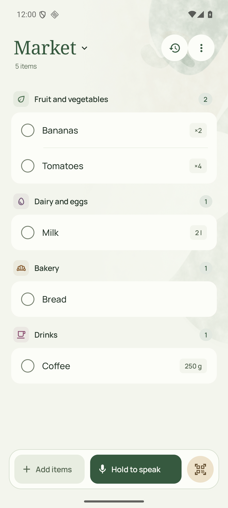
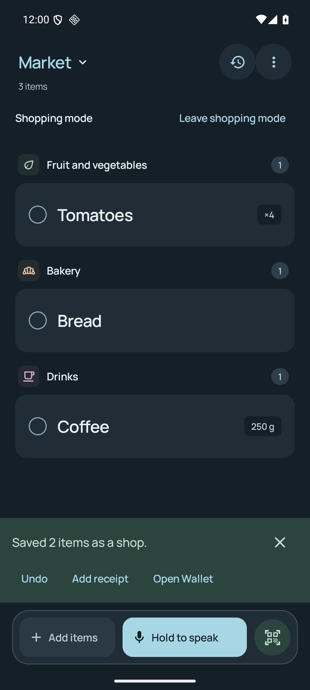
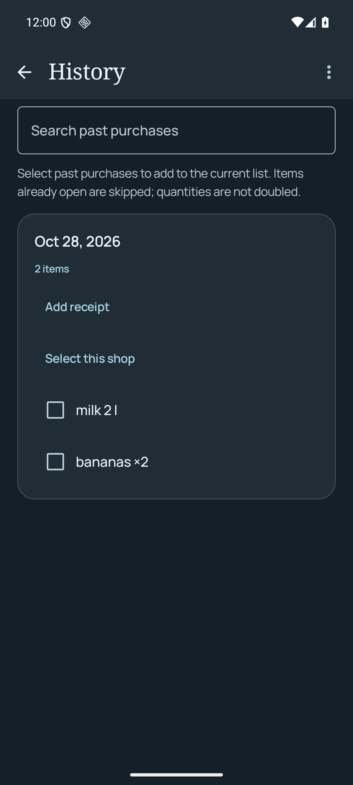

<p align="center">
  
</p>

<h1 align="center">Usuals</h1>

<p align="center">
  <strong>A shopping list that remembers what you buy.</strong><br>
  Works offline on Android. Add an optional server to share lists and edit them in your browser.
</p>

<p align="center">
  <a href="https://github.com/vitofico/usuals/releases/latest/download/app-release.apk">Download Android APK</a> ·
  <a href="#get-started">Get started</a> ·
  <a href="#your-everyday-together">Phone + browser</a> ·
  <a href="docs/README.md">Documentation</a>
</p>

<p align="center">
  <a href="LICENSE">Apache-2.0</a> · Offline first · No telemetry
</p>

<p align="center">
  <picture>
    <source media="(prefers-color-scheme: dark)" srcset="docs/assets/readme-list-tide-dark.png">
    
  </picture>
</p>

<p align="center">
  <em>The same shopping list: Grove with Artwork, or Tide with Plain.</em><br>
  <a href="docs/assets/readme-list-grove-light.png">Grove light</a> · <a href="docs/assets/readme-list-tide-dark.png">Tide dark</a>
</p>

## A little less to remember

Usuals remembers the shops you finish, so your next list starts with a little
more context. The Android app works on its own without an account, a server or a
model. The familiar colour collage stays with your list while names, quantities
and checkboxes remain easy to read.

Choose **Plum**, **Grove** or **Tide** in **Settings > Appearance** on Android or
**Preferences > Appearance** in the browser. Each follows your device's light or
dark appearance; Android's choice also carries through to the widget.
Choose **Artwork** for the layered-paper background or **Plain** for quiet
surfaces, independently of the palette. Both choices stay on this device.
[Preview the three palettes](docs/assets/palettes.svg).

These everyday shopping tools are available on Android:

| When you want to… | Usuals helps you… |
| --- | --- |
| **Catch what you need** | Type, dictate, share text or scan a barcode. Edit names, quantities, notes, categories and store tags. Open the list quickly from its home-screen widget. |
| **Remember the last shop** | Finish a shop to save checked items as dated purchases. Keep unchecked rows open, undo a finish, search history and rebuy selected items. |
| **Keep essentials coming** | Set explicit repeat rules, pin favourites and review past purchases in short rounds. Quantity hints wait for a tap; similar names merge only with your approval. |
| **Bring a recipe along** | Share a recipe link, review its ingredients and choose what to add. Existing list items are excluded; pantry staples and recent purchases start unticked. |
| **Move through the shop** | Use [shopping mode](docs/assets/readme-shopping-dark.png), store filters and aisle order. Defer an item to the next finished shop, or opt into a weekly local reminder. After finishing in shopping mode, open your chosen Wallet app. |
| **Keep receipts** | Attach a receipt photo to a finished shop, or read one with your optional image model, review the items and date, and save it into History. |
| **Keep your history** | Import a dated past list, share a list as text, or export and import shopping data through Android's file picker. |

Suggestions wait for your approval. Only repeat rules you set add items
automatically; purchase memory, favourites and review work without AI.

<details>
<summary>Purchase memory, favourites and review</summary>

**Favourites** in the list's **More options** menu are personal shortcuts. Save an
item from its editor, then tap it in Favourites when you need it again. Items
already on the list are marked; favourites never add themselves automatically.

As you type, matching names come from the current list's purchase history.
**Don't suggest again** hides an item from typing suggestions and history review
on this phone. You can still add it yourself. If it has a repeat rule, Usuals asks
before stopping that rule too.

Tap the **Replay** arrow beside History above the Android list for
**Review your usuals**: past purchases one at a time, up to ten per round.
**Add** saves immediately; **Skip** affects only this review. **Undo last choice**
restores a skipped card or removes an unchanged item added by this review. Close
whenever you like, or choose **Review more** at the end. Ranking uses the last
eight shops, frequency and time since purchase. Current items, purchases from the
last 24 hours, muted or snoozed items and repeat-rule items are excluded.
Inferred interval predictions remain disabled until replay over real household
history beats both comparison baselines. The six-step first-run tour introduces
this shortcut. Reopen it from **Settings > Help and about > Guided tour**.

To move an item, open its editor and choose **More actions > Move or copy to
another list**. Choose an active list and whether to keep the original. The new
row is unchecked and keeps its details. Moves between account lists confirm the
destination first; if the connection or either list changes, the original stays
available.

</details>

<details>
<summary>Receipts and Wallet</summary>

In **History**, open **Import receipt photo** from the menu to read a receipt or
enter its items yourself. When using server AI, update your Usuals server along with
the app to enable receipt reading. Review the date, item names and quantities before
saving the purchases and photo. Use **Add receipt** on an existing shop to keep
a photo without model calls or duplicate purchases. Tap a photo to enlarge and
zoom. Photos stay on this phone,
travel in shopping-data exports and direct device transfers, and can be saved
as individual JPEGs. They are not synced or shared with a list.

After **Finish shop** in shopping mode, **Open Wallet** opens the app you chose.
The first tap uses Android’s app picker. Change it under **Favourites > Shopping
preferences > Choose wallet app**. Usuals launches the app without reading its
contents or initiating a payment. Undo remains available after returning.

</details>

<p align="center">
  <a href="docs/assets/readme-shop-finished-dark.png"></a>
  &nbsp;&nbsp;
  <a href="docs/assets/readme-history-dark.png"></a>
</p>

<p align="center"><em>Finish the shop, then find its purchases in History. These are saved synthetic groceries in the running Android app.</em></p>

## Scan once. Know a little more.

On Android, the scanner pauses after each accepted barcode. Choose **Scan next
item** when you are ready; keeping one package in view does not fill the list
with copies.

Optional **Open Food Facts** lookup suggests a name and category, with brand and
pack size when available. Confirm the name once and reuse it offline. Missing
records can be named manually.

**Product details** shows ingredients, Nutri-Score, NOVA, declared allergens and
traces. Saved details remain available offline with a saved date, explicit
refresh and source link. Community data can be incomplete or outdated; check the
packaging for ingredients and allergens. Product data is credited to Open Food
Facts under the ODbL.

## Recipes, without the busywork

On Android, share a note or recipe URL, or choose **More options > Import recipe
or list**. Plain text and Markdown are read locally. Structured recipes are read
directly on the phone without a model. Review the proposed items before adding;
recipe imports avoid existing list items and preserve your review choices.

The browser's **List options > Import list or recipe** also offers text, file and
photo imports with review. An optional OpenAI-compatible model can read prose
recipes or, with image support, photos of written lists. AI is off by default.
Selecting a photo does not send it: you must request a read, its image check must
succeed, and you review the result before adding items.

Signed in, **Settings > Account > AI assistance** uses the server's configured
provider. Provider and model details remain available before use. See
[provider setup](docs/providers.md) for the server gateway and advanced direct
options. The everyday list needs no AI service.

<details>
<summary>Android text and Markdown import formats</summary>

Plain lists use one item per line. Bullets, numbered lists and checkboxes are
supported. Ticked entries arrive ticked, so a reused list comes in as it was.
Enable **Repeated emoji set the quantity** to read `Cerveza 🍺🍺🍺` as 3 Cerveza;
otherwise emoji stay in the name. A Markdown heading such as `# Weekend shopping`
sets a custom note title. Long notes are added in the background, batch by batch,
so the list stays usable.

</details>

## Your everyday, together

Use Android alone, or sign in to a Usuals server that you or someone you trust
runs. Signed in, your lists live in your account on that server. The phone and
browser show the same lists; the phone keeps an offline copy and sends pending
changes when it is back online.

In the web app, **Account > Connect a phone** offers a QR code. Without a computer,
you can sign in using the phone's browser. The
[connection guide](docs/server-connection.md) explains both flows.

Choose **Share** on a list to add other accounts on the same server. Everyone
added can edit the list and add others; the owner can remove people or delete the
list, and anyone else can leave it. Some server configurations also offer email
invitations. Account and invitation options depend on the server you choose.

<p align="center">
  <a href="docs/assets/web-editor.png"></a>
</p>

<p align="center"><em>The current browser interface, populated with a synthetic account-list fixture.</em></p>

| Part | What it does |
| --- | --- |
| **Android** | Offline lists, purchase history, capture and shopping tools. Signing in is optional and connects your lists to an account. |
| **Web** | Account lists, capture and import, sharing, phone pairing and account management. Sign-in options depend on the server configuration. |
| **Server** | A Kotlin/Ktor service with PostgreSQL that stores account lists, applies changes and serves the web app. You run it on your infrastructure. |

**The server and its operator can read account lists.** Encryption at rest
protects a copied database or backup, not a running server. Lists on a phone that
is not signed in never leave it. Read the [privacy policy](PRIVACY.md),
[browser boundary](web/PROTOCOL.md) and [account guide](docs/sync/web-identity.md)
before choosing a server.

Running a server also means operating its database, access controls, backups and
recovery. The [deployment package](deploy/README.md) provides preparation material
and operational checks; it does not provide a hosted instance.

**Usuals Cloud** is a separate managed-hosting project. This release does not
offer a hosted subscription. Offline Android and self-hosted use remain free. The
[hosting plan](docs/hosted-service-plan.md) records the service boundary and launch
requirements.

## Private by default

- **No telemetry, analytics, advertising, crash reporting or Play Services.**
  Lists, local purchase history and suggestions work without a network.
- **Direct, optional reads.** Native recipe URL requests go from the phone to the
  recipe site. Enabled barcode lookup sends the code to Open Food Facts, not
  your list or purchase history. No application server proxies either read.
- **Explicit AI requests.** The configured model receives submitted recipe text
  or photos after an explicit action. Server AI sends those inputs through your
  chosen server and stores personal provider keys encrypted there. Direct native
  provider keys stay in Android Keystore.
- **Speech follows Android's service.** Availability and audio processing depend
  on the selected speech service; keyboard capture works offline.
- **Portable shopping data.** Export/import and Android device transfer preserve
  shopping history. Cloud backup and secret transfer are excluded. Account
  credentials, sync state and the product cache are outside shopping exports.

See the [security model](docs/security-model.md) for the complete trust boundaries.

## Get started

Download the signed **[Android APK](https://github.com/vitofico/usuals/releases/latest/download/app-release.apk)** from GitHub Releases, or add
`https://github.com/vitofico/usuals` to **[Obtainium](https://obtainium.imranr.dev/)**
for updates. The [one-tap Obtainium import](https://apps.obtainium.imranr.dev/redirect?r=obtainium%3A%2F%2Fapp%2F%257B%2522id%2522%253A%2522io.theficos.usuals%2522%252C%2522url%2522%253A%2522https%253A%252F%252Fgithub.com%252Fvitofico%252Fusuals%2522%252C%2522author%2522%253A%2522vitofico%2522%252C%2522name%2522%253A%2522Usuals%2522%252C%2522additionalSettings%2522%253A%2522%257B%255C%2522includePrereleases%255C%2522%253Afalse%252C%255C%2522apkFilterRegEx%255C%2522%253A%255C%2522%255Eapp-release%255C%255C%255C%255C.apk%2524%255C%2522%252C%255C%2522verifyLatestTag%255C%2522%253Atrue%257D%2522%257D) selects only
stable production APKs.

GitHub CI builds, signs and publishes updates after the Android and server checks
pass. Usuals is not available on F-Droid. See the
[distribution guide](docs/distribution.md) for signatures, checksums and inclusion
status; the [corrected F-Droid draft](distribution/fdroid/README.md) remains
unsubmitted.

Android works offline without an account. Sync and shared lists use a compatible
server of your choice. Read the [privacy policy](PRIVACY.md) before enabling
external services.

The first launch includes a guided tour. Skip it whenever you like and reopen it
from **Settings > Help and about > Guided tour** on Android or **Preferences > Guided tour** in the
browser.

To build Android, install Git and Docker, then run:

```sh
git clone https://github.com/vitofico/usuals.git
cd usuals
scripts/dgradle :app:assembleDebug test --no-watch-fs
```

The APK is `app/build/outputs/apk/debug/app-debug.apk`. With Android platform-tools
installed, select your emulator explicitly:

```sh
adb -s emulator-5554 install -r app/build/outputs/apk/debug/app-debug.apk
```

Every Gradle build and test uses `scripts/dgradle`. For the server's real
PostgreSQL integration suite and distribution build:

```sh
server/scripts/test-local
```

Use the [server guide](server/README.md) and [deployment runbook](deploy/README.md)
for instance preparation. Production deployment is an explicit operator action.
The [development guide](docs/development.md) covers full tests, native 16 KB
alignment, emulator checks and suggestion replay. See the
[verification record](docs/release-check.md) and [known issues](docs/known-issues.md)
for tested scope and remaining limits.

## Make Usuals speak your language

English is the default. Spanish, Italian, French and German are included in both
the Android interface and the web editor. Input languages are independent of
the display language.

Android translations are complete `values-xx/` resource folders, with automatic
locale discovery and parity checks. The browser uses complete locale catalogs.
No registry change is needed to add a language. The
[translation guide](docs/translating.md) explains the workflow, helper script and
glossary; you can improve the copy without installing Android tooling.

## Contribute

Read the [contribution guide](CONTRIBUTING.md),
[architecture](docs/architecture.md) and [roadmap](docs/roadmap.md). Preserve
migration paths, optional network access and fast offline capture.

Maintained by [@vitofico](https://github.com/vitofico).

## License

[Apache License 2.0](LICENSE). Bundled dependencies and fonts retain their own
licenses and notices. See the [contribution agreement](CLA.md).

## Support

If Usuals is useful to you and you'd like to chip in, you can buy me a coffee:

[](https://ko-fi.com/vito507767)
