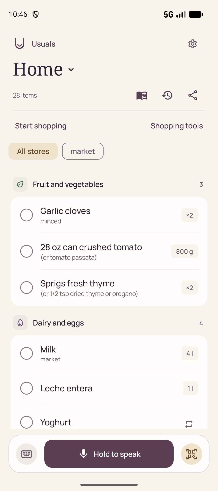
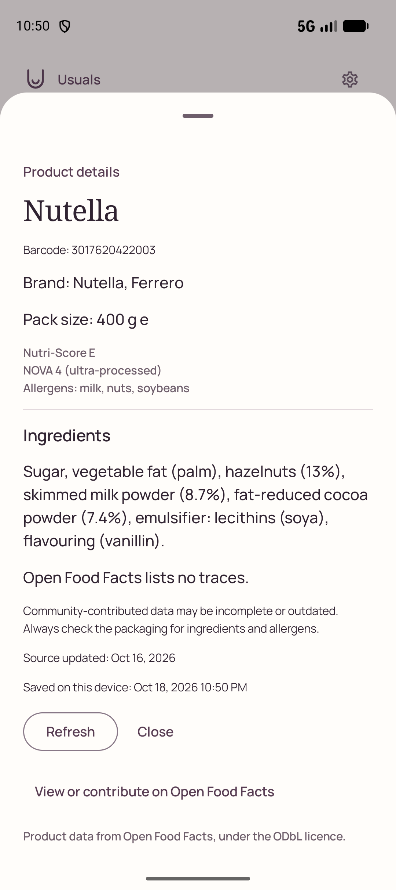
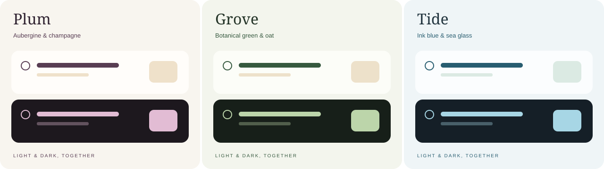
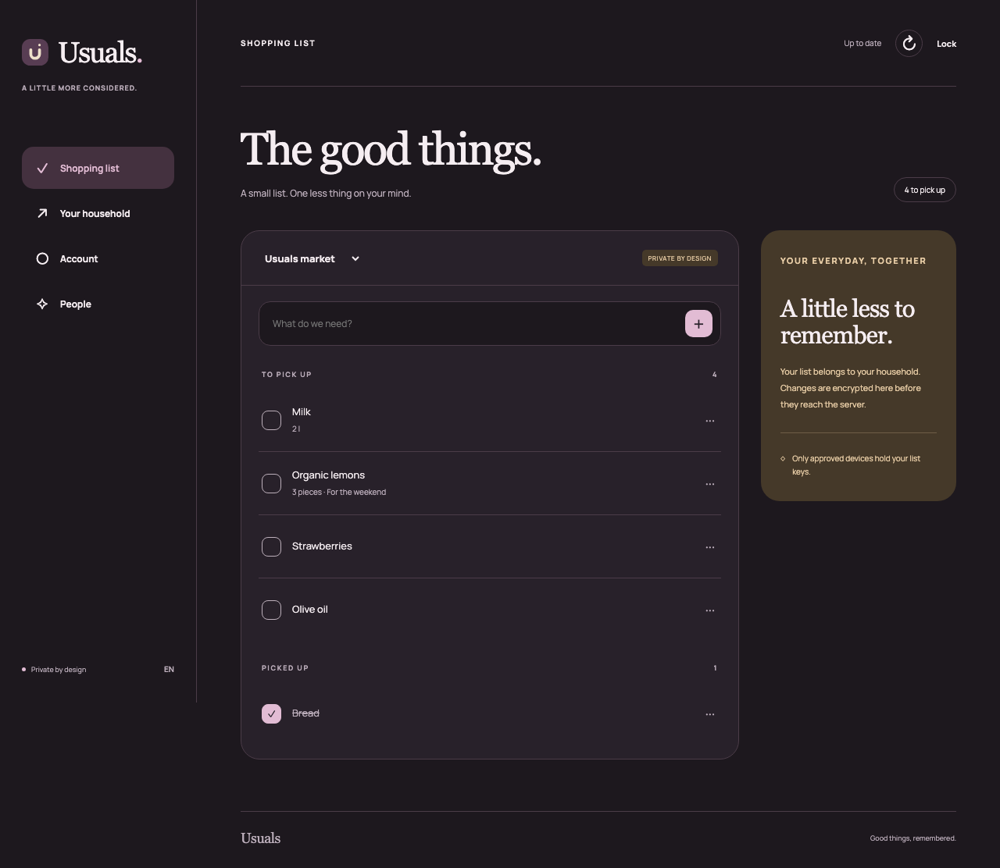

<p align="center">
  
</p>

<h1 align="center">Usuals</h1>

<p align="center">
  <strong>A shopping list with a memory. And room for your household.</strong><br>
  Capture on Android. Remember what you buy. Share an encrypted list on your own server.
</p>

<p align="center">
  <a href="#a-little-less-to-remember">Explore</a> ·
  <a href="#your-everyday-together">Shared lists</a> ·
  <a href="#get-started">Get started</a> ·
  <a href="docs/translating.md">Translations</a> ·
  <a href="docs/README.md">Documentation</a>
</p>

<p align="center">
  <a href="LICENSE">Apache-2.0</a> · Android + Web · Offline first · No telemetry
</p>

<p align="center">
  <a href="docs/assets/android-list.png"></a>
  &nbsp;&nbsp;&nbsp;
  <a href="docs/assets/android-product.png"></a>
</p>

<p align="center"><em>Everyday essentials. A considered design. Your data stays yours.</em></p>

## A little less to remember

Usuals remembers the shops you finish, so the next list starts with a little
more context. The Android app works on its own, without an account, a server or
a model. Warm paper, aubergine accents, serif headings and a matching dark theme
keep the list easy to read in the kitchen and at the shop.

Choose **Plum**, **Grove** or **Tide** in **Settings > Appearance**. Each palette
has a matching dark mode, follows your device and carries through to the widget.
The web editor offers the same choices from its Appearance control.



| When you want to… | Usuals helps you… |
| --- | --- |
| **Catch what you need** | Type, dictate, share text or scan a barcode. Edit names, quantities, categories and store tags. Add the home-screen widget for a quicker way back in. |
| **Remember the last shop** | Finish a shop to save checked items as dated purchases. Keep unchecked rows open, undo a finish, search history and rebuy selected items. |
| **Keep the essentials coming** | Set explicit repeat rules, pin essentials and choose from up to six suggestions. Quantity hints wait for a tap; similar names merge only with your approval. |
| **Turn a recipe into a list** | Share a recipe link, review its ingredients and choose what to add. Already-listed items are excluded; pantry staples and recent purchases start unticked. |
| **Move through the shop** | Use a focused shopping mode, store filters and aisle order. Defer an item to the next finished shop, or opt into a weekly local reminder. |
| **Keep your history** | Import a dated past list, share a list as text, or export and import shopping data through Android's file picker. |

Only your explicit repeat rules add items automatically. Inferred interval
predictions stay disabled until replay over real household history beats both
baselines. Staples, purchase memory and explicit repeats work now.

## Scan once. Know a little more.

The scanner pauses after each accepted barcode. Choose **Scan next item** when
you are ready; holding the same package in view does not fill the list with
copies.

Enable **Open Food Facts** lookup to get a suggested name and category, with
brand and pack size when available. Confirm the name once and reuse it offline.
Missing records can still be named manually.

Open **Product details** on a barcoded item for ingredients, Nutri-Score, NOVA,
declared allergens and traces. Saved details remain available offline, with a
saved date, explicit refresh and a link to view or improve the source record.
Community data can be incomplete or outdated; check the packaging for ingredients
and allergens. Product data is credited to Open Food Facts under the ODbL.

## Recipes, without the busywork

Share a recipe URL into Usuals or paste it in the recipe screen. Structured
recipes are read directly on the phone and need no model. Review the ingredients
before adding them; Usuals preserves your choices and avoids existing list
items. Sites that block the request show an explanation.

For prose recipes, an optional OpenAI-compatible model can help with extraction.
It is off by default, runs only after your explicit action and uses the endpoint
you configure. The everyday list needs no AI service.

## Your everyday, together

Use Android alone, or connect a household to your own encrypted relay. Approved
devices share lists with explicit roles, membership changes and conflict review.
The relay stores encrypted shopping contents; membership and routing metadata
remain visible to the server.

<p align="center">
  <a href="docs/assets/web-editor.png"></a>
</p>

<p align="center"><em>Android in your pocket. A larger workspace in your browser.</em></p>

| Part | What it does |
| --- | --- |
| **Android** | Offline lists, purchase history, capture and shopping tools. Encrypted sharing is optional; everyday use needs no sign-in. |
| **Web** | Edit a shared list through an encrypted browser vault. Controlled standalone accounts or optional Authentik SSO provide sign-in; the household owner still approves membership. |
| **Relay** | A small Kotlin/Ktor service with PostgreSQL, signed authorization, encrypted operations and backup/recovery tools. You run it on your infrastructure. |

Browser encryption trusts the code served by your instance: an operator who
changes that code could observe an unlocked vault. Owner bootstrap and recovery
remain on Android. Read the [browser boundary](web/PROTOCOL.md),
[Android sharing guide](docs/sync/android-sharing.md) and
[account/SSO guide](docs/sync/web-identity.md) before inviting a household.

The server and clients are implemented and tested locally. Cluster deployment,
production capacity, off-site recovery and a household pilot still need their
operational checks. The [deployment package](deploy/README.md) is preparation
material, not a running hosted service.

**Usuals Cloud** is planned as optional paid managed hosting. Offline and
self-hosted use remain free; billing and paid onboarding are not implemented.
The [hosting plan](docs/hosted-service-plan.md) records the work and launch gates.

## Private by default

- **No telemetry, analytics, advertising, crash reporting or Play Services.**
  Lists, local purchase history and suggestions work without a network.
- **Direct, optional reads.** Recipe requests go from the phone to the recipe
  site. Enabled barcode lookup sends the code to Open Food Facts, not your list
  or purchase history. No application server proxies either read.
- **Your model, your choice.** Recipe text reaches the configured model only
  after an explicit action. The provider key stays in Android Keystore.
- **Speech follows Android's service.** Availability and audio processing depend
  on the selected speech service; keyboard capture works offline.
- **Portable shopping data.** Export/import and Android device transfer preserve
  shopping history. Cloud backup and secret transfer are excluded. Encryption
  keys, household membership and the product cache are outside shopping exports.

See the [security model](docs/security-model.md) for the complete trust boundaries.

## Get started

This is a private source preview. Sign in to GitHub with an account that has
repository access. No signed release APK, store listing or managed service is
published yet. To build Android, install Git and Docker, then run:

```sh
git clone https://github.com/vitofico/usuals.git
cd usuals
scripts/dgradle :app:assembleDebug test --no-watch-fs
```

The APK is `app/build/outputs/apk/debug/app-debug.apk`. With Android platform-tools
installed, select your emulator explicitly:

```sh
adb -s emulator-5554 install -r app/build/outputs/apk/debug/app-debug.apk
```

Every Gradle build and test uses `scripts/dgradle`. For the server's real
PostgreSQL integration suite and distribution build:

```sh
server/scripts/test-local
```

Use the [server guide](server/README.md) and [deployment runbook](deploy/README.md)
for instance preparation. Account setup and household enrollment are separate
steps. Production deployment is an explicit operator action.

The [development guide](docs/development.md) covers full tests, native 16 KB
alignment, emulator checks and suggestion replay. The
[verification record](docs/release-check.md) and [known issues](docs/known-issues.md)
explain the tested scope and remaining limits.

## Make Usuals speak your language

English is the default. Spanish, Italian, French and German are included in both
the Android interface and the web editor. Input languages are independent of
the display language.

Android translations are complete `values-xx/` resource folders, with automatic
locale discovery and parity checks. The browser uses complete locale catalogs.
No registry change is needed to add a language. The
[translation guide](docs/translating.md) explains the workflow, helper script and
glossary; you can improve the copy without installing Android tooling.

## Contribute

Read the [contribution guide](CONTRIBUTING.md),
[architecture](docs/architecture.md) and [roadmap](docs/roadmap.md). Preserve
migration paths, optional network access and fast offline capture.

Maintained by [@vitofico](https://github.com/vitofico).

## License

[Apache License 2.0](LICENSE). Bundled dependencies and fonts retain their own
licenses and notices. See the [contribution agreement](CLA.md).
