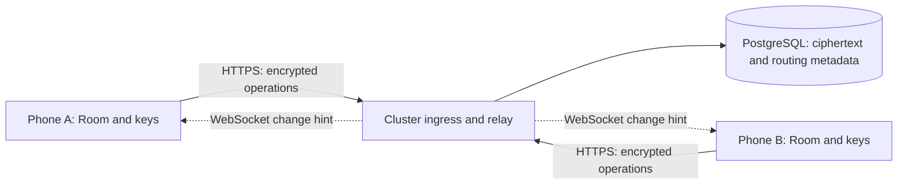

# Shared lists implementation plan

2026-10-16. Vito authorized continuing all remaining local implementation phases. The
[S0 contract](sync/README.md) records the protocol, reviewed security rules,
fixtures, migration design and inventory learned from existing services.
No cluster relay is deployed and no cluster access or deployment has started.
Deployment requires explicit approval after local verification.

S0 through S3 are complete locally. S4 Android sharing is implemented and
verified on two emulators: encrypted shopping exchange, concurrent edits and
Finish/Undo, offline reboot and stale keys, explicit barcode merges, member
removal and pending-work retention. A fresh authorized physical-phone pass and
longer household use remain S4/S5 acceptance gates, not emulator claims.

The [local foundation](sync/local-foundation.md), [relay](../server/README.md),
[Android keys](sync/android-keys.md) and [Android sharing](sync/android-sharing.md)
describe the current implementation. The S4 Docker gate passes 799 Android-build
tests and 53 isolated server-build tests, zero failures/errors, with three
opt-in OFF skips only. Lint has zero errors and both APKs pass 16 KB alignment.
[Release evidence](release-check.md) records checks, hashes and limits.

S5 local preparation is implemented: reviewed manifests, recipient-scoped frozen
exports, offline local-copy recovery, bounded admission/private metrics, backup
and restore tools/runbooks. Docker gates pass 812 Android-build and 69 server-build
tests, zero failures/errors, three OFF skips only. Two-emulator recovery preserves
newer/pending work; a real encrypted export also imports in the optimized release.
Native 16 KB alignment and actual Keystore tests pass. Resource smoke and local
base/WAL restore evidence are in the release record. These are local checks;
live capacity/retention/off-site targets remain to be measured.
The 2026-10-18 follow-up adds a clean-commit, hash-verified deployment bundle
with both amd64 images, separate operator jobs and validated nonsecret inventory.
Latest active-module test totals and authenticated local profile/restore evidence
are recorded in the release checklist; earlier Android totals included stale
reports from the deleted shop module.
Actual cluster deployment requires separate approval. The two-person week-long
pilot follows deployment and cannot be completed by local tests.

## Product scope

Keep the app usable without sharing, an account or a connection. Add named
lists and a list picker. A household owns shared lists; its members can edit
all of them. Start with owner and editor roles, rather than per-list roles.
An owner can invite, remove members and transfer ownership to an accepted
member. Removing the last owner requires deleting the household or transferring
ownership first. Each person may have more than one device.

Sharing an existing list previews what will leave the device. Share its current
rows, confirmed aliases, category overrides and explicit repeat rules. Historical
trips are an explicit, initially unticked option. Keep an independent local copy
until the initial encrypted upload is acknowledged. Joining another household
creates a separate list; never silently merge two phones' existing data.

Once shared, a list's trips and purchases are shared with its members so its
shopping memory is consistent. Suggestion dismissals, speech configuration,
model endpoints/keys, model usage, catalog consent and the product cache remain
device-local. Recipe and catalog requests still originate on each phone.
No email service, social login, web client, photos or model service in the MVP.

## Recommended stack

One isolated `server/` Kotlin/JVM process using Ktor/Netty, JSON over HTTPS and a
WebSocket for change hints. Reuse Kotlin serialization and contract fixtures,
but keep Android and Room dependencies out of the server. Ktor provides
[WebSocket support](https://ktor.io/docs/server-websockets.html) and
[container deployment](https://ktor.io/docs/server-deployment.html).

Use PostgreSQL with SQL migrations, a small JDBC pool and a bounded database
dispatcher. Prefer a dedicated database and role on an already operated
PostgreSQL service; otherwise run one persistent database instance. No Redis,
queue broker or object store is needed for list operations. The durable event
table is the queue. Initially use one relay replica; a restart loses connections,
not acknowledged writes. Cross-replica notification can later use
[LISTEN/NOTIFY](https://www.postgresql.org/docs/current/sql-notify.html) as a
wake-up hint while readers always catch up from the event table.

The local service inventory establishes single-node MicroK8s, Traefik,
cert-manager and Kustomize. Follow the [recorded conventions](sync/operations.md)
with a ClusterIP service and one relay Deployment. Live readiness remains unverified.
Provisional requests: relay 100m CPU/256 MiB, limit 1 CPU/512 MiB; a new database
500m/512 MiB with a 1 GiB memory limit and 10 GiB persistent storage. These are
starting budgets, not measured capacity. Confirm against the cluster before
writing manifests. Pin supported dependency versions and image digests at S0;
check their Kotlin/JVM requirements against the current Kotlin 2.0.20 build
before proposing a toolchain update.

## Identity, invitations and encryption

Generate device signing and recipient-encryption key pairs on the phone.
Authenticate the relay with short-lived opaque sessions after a single-use
challenge signed by the registered device key. Bind challenges to the server,
device and expiry; reject replay. Persist only hashes of bearer sessions.
First household creation needs a cluster-managed bootstrap invitation so a
public endpoint cannot register unlimited devices or households.

Use Tink as the candidate library: AEAD for list contents, HPKE for wrapping a
list epoch key to each accepted device, and signatures for operations and
membership changes. Tink documents Java support for these
[primitives](https://developers.google.com/tink/supported-key-types) and an
[Android library](https://developers.google.com/tink/setup/java) supported below
the app's API 26 minimum. Prefer its Java implementation, then verify APK
size, licenses and 16 KB compatibility. Do not implement cryptographic primitives.

An owner issues a short-lived, one-use QR/link invitation. It pins the server
origin and household identity plus an unpredictable invitation secret. Opening
it submits a join request, not membership. Both people verify a device-key
fingerprint through the QR or a separate trusted channel; the owner explicitly
approves the recipient keys before wrapping any list keys. Redact links and
secrets from logs, browser history and diagnostics. A relayed public key alone
is never sufficient proof of the recipient's identity.

Encrypt payloads and snapshots with an independent random key per list and
membership epoch. Bind protocol version, list, epoch, operation id and author
as associated data; sign the exact versioned envelope bytes. HPKE does not
authenticate the sender by itself, so key packages also require the owner's
signature. Clients verify the signed membership chain from the owner identity
pinned in the invitation before accepting authors or key packages. See Tink's
[AEAD](https://developers.google.com/tink/aead) and
[hybrid encryption](https://developers.google.com/tink/hybrid) boundaries.

Protect private keysets and list keys using an
[Android Keystore](https://developer.android.com/privacy-and-security/keystore)
wrapping key. Keep them outside Room exports, cloud backup and device-transfer
rules. Restoring a database must require re-enrolment, not reuse another phone's
device identity. A second surviving owner device can enrol a replacement.
Offer an explicit encrypted recovery kit with a randomly generated recovery
secret stored by the person. Test recovery before suggesting that it is safe
to remove the last device. The server cannot reset a lost encryption key.

Removal revokes sessions and rotates the household membership epoch and all
affected list keys. Remaining devices receive new key packages; stale devices
must refresh membership before uploading. Retained members may explicitly
resubmit queued intents under the new epoch; removed members keep unsent edits
locally and may export them. Removal cannot erase data already decrypted by a
former member. New members get the current shared history through a fresh
snapshot, rather than every retired epoch key.

The relay sees IPs, opaque list/device ids, membership, timing and ciphertext
sizes. It cannot read names, quantities or history. Signatures and authenticated
encryption reject modification and replay; they do not ensure availability.
Persist signed checkpoints to detect a rollback relative to a device's known
head. A new device can still receive a selectively stale view from a malicious
relay. Do not claim full fork detection, forward secrecy or protection from a
compromised member device. S0 must review the complete key and membership
protocol before real household data is used.

## Local data and convergence

Schema 4 has no persisted list or membership scope. `Household` and `Member`
types are not an existing sync implementation. Add a versioned Room migration,
initially 4 to 5, with migration tests preserving every schema-4 record:

- `household`, `list`, membership/device references and current selection.
- List scoping for items, trips, purchases, aliases and shared preferences.
  Separate shared rules/category overrides from local mutes and snoozes.
- A transactional outbox, received-operation ledger, per-list cursor, field
  revisions and tombstones. Secrets stay behind the `:auth` key store.
- A versioned archive format with backward import of existing format 1.
  Sync identity, sessions and key material are never a shopping-data archive.

All local mutation paths, including capture, recipe confirmation, repeat
maintenance, Finish, Undo and imports, write their mutation and durable intent
in one transaction. The UI reads Room immediately. Use a pure JVM `:sync`
protocol/reducer and Android transport/work adapters; let `ServiceLocator`
construct all production collaborators. Keep all display copy in `:app`.

Prefer a simple, ordered operation log over a general CRDT. The relay orders
opaque signed envelopes; clients validate their contents and reduce them.
Allocate a per-list sequence under a row lock in the same transaction as the
insert. A PostgreSQL sequence allocated before commit is insufficient: a
later committed cursor could skip an earlier in-flight transaction.
Replay from a validated snapshot plus log, then rebase optimistic pending
intents. An acknowledged operation must have a stable id and ciphertext digest;
a repeated id with different bytes is a conflict, not an overwrite.

| Concurrent case | Proposed deterministic behavior |
|---|---|
| Different fields of a row | Apply independently using per-field revisions. |
| Same field changed offline | Compare expected field revision; retain the stale intent as a visible conflict with both values. Never choose by phone wall clock. |
| Same operation retried | Unique operation/intent id makes it apply once, including after a crash before the acknowledgement. |
| Two captures of one identity | First accepted row owns the live identity. Explicit compatible quantities may add once per capture; absent quantities do not invent amounts. Incompatible units require review. |
| Check and uncheck | Revision-guarded state changes. A stale toggle is a conflict, not an automatic reversal. |
| Delete versus old edit | A tombstone blocks mutations of the old row incarnation. Re-adding creates a new item id. |
| Two Finish actions | Each names exact checked rows/revisions and frozen final facts. First accepted close claims each item; later closes cannot buy it again. An empty close creates no trip. Changed rows remain open for review. |
| Undo versus later edits/close | Undo references its accepted trip and row incarnations. Retract only that trip's purchases and unchanged dependent repeats. Preserve later edits. Report rows that cannot be restored. |

Purchase ids remain item-derived, scoped to a list. At most one effective
purchase exists per item. An accepted Undo cancels the prior close in the log;
a later close can create a new effective fact only after that cancellation.
Immutable facts from a still-effective close cannot be rewritten by import.
Persist rejected/conflicting intents separately so convergence never silently
drops a person's offline work. Validate alias cycles, normalizer versions,
amounts, schema and bounded payload sizes before reduction.

Automatic repeat additions also need a shared deterministic occurrence id from
list, canonical identity, rule revision and due purchase. Otherwise two offline
phones could each create the same due row. Keep inferred intervals disabled.
S0 must specify reducer fixtures for all cases above before transport is built.

## Relay contract and storage

Version `/v1`. Draft endpoints: device challenge/session, household creation,
invitation request/approval, membership updates, key packages, list discovery,
operation append/read after cursor, snapshot upload/read, and a WebSocket
change stream. Provide an OpenAPI contract plus binary signing fixtures.
Return structured error codes, with English rendering only in `:app`.

Persist devices/public keys, hashed sessions, household/member/list routing,
expiring invitation hashes, signed membership epochs, wrapped key packages,
encrypted operations, checkpoints and encrypted snapshots. Put membership
changes and their log cutoffs in one transaction. Every endpoint checks
membership and device revocation, including snapshot reads and WebSocket
subscriptions. Close sockets when access is revoked.

Initial configurable limits: 64 KiB per operation, 100 operations per append,
1 MiB ordinary request, 10 MiB snapshot upload, 8 devices per member and 20 members per
household. Apply per-device, household and IP limits; bounded connection pools,
timeouts and cursors; expire challenges/invites/sessions. Include retention and
quota errors in the UI without deleting local data.

Do not compact away operations or tombstones in the MVP. An encrypted snapshot
accelerates joining, but does not authorize deleting its source log. Later
compaction requires verified checkpoints, inactive-device expiry, a complete
resync path and tests against resurrection. Document a storage quota first.

## Delivery and operation

While a shared list is visible, reconnect its WebSocket with bounded backoff
and jitter; hints trigger cursor reads. Always catch up on open, resume and
reconnect. Use unique network-constrained WorkManager work to drain the
outbox and retry after process death, following Android's
[offline-first queue guidance](https://developer.android.com/topic/architecture/data-layer/offline-first?hl=en).
Background delivery is eventual: Android defers persistent work and periodic
work has a [15-minute minimum](https://developer.android.com/develop/background-work/background-tasks/persistent/getting-started/define-work).
No FCM, Play Services or permanent foreground service. A foreground target of
two seconds on a healthy connection is a test target, not a background promise.

UI states: local-only, synced, pending changes, offline, conflict, needs key,
access removed and upgrade required. Keep the list interactive in all of them.
After leaving, offer to retain an independent local copy or remove this
device's copy. Never send it to another household implicitly.

Use non-root containers, resource limits, a read-only relay filesystem,
network policies and secrets supplied by the cluster. No keys/tokens/payloads
in logs or ingress URLs. Expose separate liveness and database readiness checks.
Collect aggregate request errors, latency, queue age, storage and socket counts
without household ids as metric labels or any analytics SDK in the app.

Use the cluster's database backup system with encrypted off-cluster copies.
Set a proposed recovery point target of 15 minutes and recovery time of 2 hours;
validate them with a restore drill rather than assuming snapshots are enough.
PostgreSQL documents [WAL archiving and recovery](https://www.postgresql.org/docs/current/continuous-archiving.html).
The [S0 restore boundary](sync/security-v1.md) freezes restored household ids
before authentication, including fresh challenges from revoked devices. A
verified recovery copy gets a fresh household and keys; old identities never
resume automatically. Clients pin membership hashes as well as list heads.
Document database upgrades, relay rollback, membership/key recovery and deletion
including backup expiry. The server backup cannot replace users' recovery keys.

## Ordered implementation gates

| Phase | Deliverable | Done when |
|---|---|---|
| S0: contract | Approve scope, threat model, reviewed crypto/membership protocol, reducer fixtures, archive/migration design and cluster inventory | Independent protocol review resolves key substitution, revocation, replay, recovery and concurrent Finish/Undo; versions and limits pinned. No deployment. |
| S1: local foundation | Named lists, 4-to-5 migration, pure reducer, atomic outbox and local pending/conflict UI | All schema-4 fixtures preserved; two fake replicas converge under replay, clock skew, duplicate delivery, all mutation paths and process interruption. Single-phone flows still work offline. |
| S2: relay locally | Ktor process, PostgreSQL migrations, auth, authorization, durable append/read and hints | Docker integration tests cover cross-household denial, concurrent append/commit ordering, retry, size/rate limits, rollback and restart. Database/log inspection reveals no shopping plaintext. |
| S3: keys and joining | QR/link approval, encrypted envelopes/snapshots, rotation, recovery kit and re-enrolment | API-26+ devices and the 16 KB emulator exchange encrypted fixtures; modified/replayed/wrong-recipient packages fail; expired/reused invitations and revoked devices are denied; recovery works after reinstall. |
| S4: Android sharing | List picker, sharing preview/history choice, transport, workers, membership UI and conflicts | Two emulators plus an authorized physical-phone pass add/edit/check/Finish/Undo concurrently, including hours offline, disconnect during acknowledgement, reboot and stale keys. No duplicate purchases or lost pending work. |
| S5: staging and pilot | Reviewed cluster manifests, backup/restore runbook and two-person pilot | Separate deployment approval; restore/rollback/revocation drills, foreground latency target and resource budgets pass. A week of household use has no unexplained loss or duplication before inviting more people. |

For every implementation phase run Docker builds, the full test suite and
lint through `scripts/dgradle` in the background, verify applicable emulator
flows, update `internal/pivot-plan.md` section 8, and commit locally on
`feat/smart-list`. Extend that wrapper's Docker environment for server database
tests instead of invoking Gradle directly. Preserve both APK native alignment
gates, locale parity and secret scans. No remote or push.

S0 records the local cluster/service evidence, dependency and image pins,
reviewed protocol and synthetic fixtures. S1 implements the local reducer and
versioned migration; S2 implements and tests the isolated relay. Server deployment remains gated by live DNS/TLS,
storage, backup/restore checks and Vito's explicit approval.
